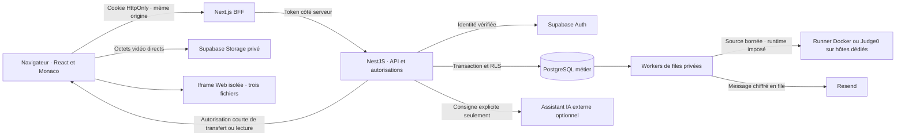
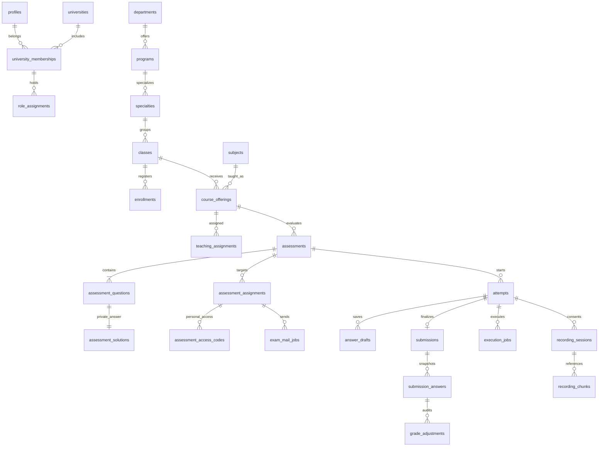

# Architecture et modèle de données

## Décisions et état réel

UniExam utilise **Next.js, NestJS et PostgreSQL/Supabase**. Nest reste un monolithe modulaire TypeScript pour l’identité, la structure et le cycle d’examen. Les environnements pédagogiques exécutant du code sont séparés : PHP ou Java ne deviennent pas des backends supplémentaires de l’application métier.

Next fournit l’interface et un BFF qui garde le token de session dans un cookie HttpOnly. Nest expose `/api/v1`, vérifie identité et périmètre, puis utilise les schémas Zod et les transactions SQL. Supabase Auth vérifie l’identité en mode connecté. Le mode démo utilise explicitement PGlite et des comptes fictifs ; il refuse la production et l’écoute non locale.

Les files **d’exécution et d’email PostgreSQL existent**. Elles sont consommées par des workers à petits lots dans le processus API. L’exécution passe par un daemon Docker séparé ou un Judge0 privé. Nest ne reçoit ni socket Docker ni compilateur local. Le stockage vidéo Supabase est intégré mais désactivé sans configuration. Redis/BullMQ, workers autonomes, autoscaling et plusieurs régions restent des évolutions d’exploitation, pas des services déjà installés.

## Frontières de confiance

Le navigateur est non fiable. Un rôle, identifiant d’université, code personnel ou horaire fourni par le client ne suffit pas à autoriser une action. La session est vérifiée, puis `AcademicService.scope` contrôle l’adhésion active. Les transactions métier fixent `auth.uid()` depuis l’identité vérifiée et utilisent `SET LOCAL ROLE uniexam_api`. Les paramètres SQL portent les valeurs utilisateur ; les noms de tables dynamiques proviennent de registres statiques.

Les rôles Supabase `anon` et `authenticated` n’ont aucun accès direct aux tables applicatives. Un JWT encore valable ne doit pas contourner la révocation de la session via la Data API. `uniexam_api` est NOLOGIN ; seule la connexion de service Nest peut prendre ce rôle. Les helpers RLS `SECURITY DEFINER` utilisent un `search_path` vide et des noms qualifiés. Le rôle opérateur/migration reste privilégié ; séparer les comptes de migration, application et workers et finaliser leurs grants avant production.

Le token reste hors du JSON de connexion et du stockage JavaScript du navigateur. Le BFF vérifie l’origine des mutations, refuse les redirections amont et borne le corps pendant lecture. Les quotas d’écriture suivent l’acteur authentifié ; les quotas de connexion suivent le compte validé. Ils ne sont pas distribués entre réplicas. La démonstration persistante acquiert un verrou exclusif avant d’ouvrir PGlite, libéré seulement après fermeture et flush.

## Modèle relationnel livré

La structure comprend également établissements facultatifs, niveaux, années, semestres et groupes. Les UUID et clés étrangères composites contenant `university_id` empêchent les associations entre établissements non autorisées. Classes, spécialités, départements et calendrier ont des contraintes de cohérence. Une personne peut posséder plusieurs adhésions et plusieurs rôles scoped indépendants ; SUPER_ADMIN n’est pas une affectation pédagogique implicite disponible.

La publication fige les questions, horaires et barèmes et crée l’ensemble des destinataires inscrits. Les solutions attendues QCM sont séparées dans `private.assessment_solutions`. Les codes d’accès aléatoires sont liés à l’identité et stockés sous forme de hash. Une tentative unique reçoit une échéance serveur. Les réponses versionnées utilisent une concurrence optimiste ; remise et expiration produisent une copie immuable avec snapshot des questions. Les notes publiées restent verrouillées, avec historique des corrections.

Les fichiers Web sont sérialisés dans une réponse validée `{format, files}` contenant exactement `index.html`, `style.css` et `script.js`. Le `JSONB` sert aussi aux options, snapshots et sorties IA validés ; la structure universitaire reste normalisée. Le runtime est fixé dans la question. Le catalogue distingue l’exécution sur le runner, dont SQLite éphémère avec Docker, et le Web avec aperçu navigateur.

## Traitements et flux de données

**Exécution.** Le client demande l’exécution de la dernière version enregistrée ; il ne fournit ni commande shell, URL de rappel ni langage libre. La file privée assure un état durable, un quota par étudiant et une seule exécution active par tentative. Le worker réclame un lot, appelle le fournisseur configuré, conserve son identifiant privé puis consulte le résultat. Une acceptation ambiguë n’est pas automatiquement relancée. Les sorties sont du texte borné ; le code transitoire de la file est effacé après acceptation ou échec. Aucun SQL étudiant ne rejoint la base métier.

**Email.** L’enseignant choisit des adresses correspondant à des destinataires déjà actifs. La file stocke le message incluant le code chiffré AES-256-GCM. La migration 007 garde l’historique, évite plusieurs jobs courants et autorise une réémission explicite après échec/expiration. Un nouveau job obtient un nouveau code et une nouvelle clé d’idempotence. Les mises à jour vérifient encore le claim pour ignorer un acquittement tardif. Les résultats SENT indiquent seulement l’acceptation fournisseur.

**Vidéo.** L’étudiant choisit la surface après consentement. Le navigateur fabrique des clips autonomes, réserve leur métadonnée auprès de Nest puis transfère les octets directement vers une URL Storage signée. L’API revérifie taille et MIME réels avant confirmation. Les chemins sont générés serveur ; seule la consultation enseignant autorisée reçoit un lien court. La base conserve sessions, consentement, baux, références et rétention, jamais les octets. Le CLI de purge et son ordonnanceur cloud sont deux éléments distincts : seul le premier est livré.

**Similarité et IA.** La comparaison lexicale s’applique localement aux copies remises d’un examen autorisé, exclut les séquences du code initial et renvoie un nombre limité de rapprochements. Elle n’identifie pas l’auteur et ne mesure pas l’utilisation d’une IA. L’assistant pédagogique externe reçoit seulement la matière, l’objectif saisi et les paramètres nécessaires, sans profil, email, vidéo ou copie envoyés automatiquement. Sa sortie validée reste un brouillon privé à relire.

## Évolution et limites

Le mode démo ne valide pas Supabase distant, une base multi-connexion, Docker, un runner réel ou la capacité du réseau. Les migrations sont numérotées et transactionnelles, appliquées automatiquement uniquement en démo ; en Supabase elles relèvent d’une étape opérateur. Les index couvrent le tenant, les affectations, les files, leurs échéances et les quotas. Les écritures auditées et leur audit appartiennent à la même transaction.

Restent à construire : banque de questions versionnée réutilisable, sections d’examen, aménagements individuels, multi-tentatives, projets serveur à plusieurs fichiers avec dépendances, corrections automatisées par tests privés, contestations et administration complète des comptes. Ils ne sont pas présentés comme des tables déjà migrées.

Voir [le plan de capacité](CAPACITY_PLAN.md) pour les objectifs mesurables, partitions, admission globale, quotas cloud, workers dédiés et restauration. L’architecture prépare ces séparations ; elle ne démontre pas cent millions de connexions simultanées. Les garanties et limites opérationnelles sont détaillées dans [la revue de sécurité](SECURITY_REVIEW.md).
