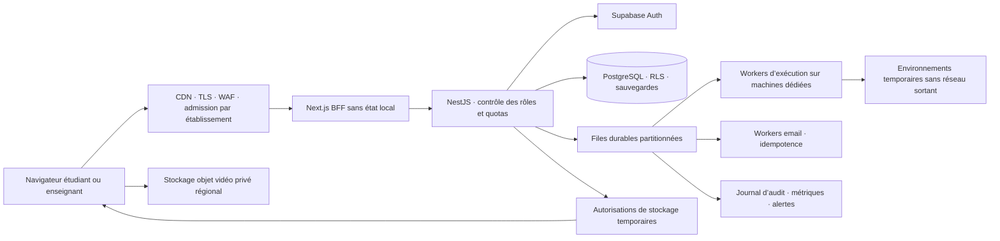

# Capacité, exploitation et évolution de l’architecture

Le dépôt contient une application fonctionnelle et des protections locales. Il ne contient ni infrastructure provisionnée pour cent millions de connexions simultanées, ni mesure prouvant une telle capacité. PGlite sert exclusivement à la démonstration et aux tests ; sa base persistante est mono-processus. Cent millions de comptes inscrits, cent millions d’utilisateurs mensuels et cent millions de candidats simultanés sont trois objectifs très différents.

## Architecture cible et frontières

**Présent dans le code :** BFF Next, API Nest, RLS et frontières d’université, stockage Supabase configurable, file d’exécution PostgreSQL, file email chiffrée, identifiants de requête, quotas d’exécution, segments vidéo avec limites. **À déployer ou faire évoluer :** périphérie CDN/WAF, admission distribuée, orchestration des workers, séparation des comptes PostgreSQL, régions et partitions, collecte de métriques, SLO, sauvegardes/restaurations, astreinte. Les files actuelles utilisent PostgreSQL et de petits lots dans les processus API ; le schéma ne prétend pas déjà déployer Redis ou Kafka.

La sauvegarde d’une réponse est acquittée après commit. Conserver cette garantie ; une file asynchrone ne doit pas afficher « enregistré » avant durabilité. Isoler les transactions courtes de copies du travail lent d’exécution, de vidéo et d’IA. Les octets vidéo vont directement au stockage objet via une autorisation serveur ; la base ne conserve que les métadonnées. Ces métadonnées restent volumineuses : il faut aussi les partitionner et définir leur rétention.

Avant plusieurs réplicas, remplacer les limiteurs mémoire par une admission partagée et équitable par étudiant et établissement. L’IP vue par Nest est souvent celle du BFF ; elle ne constitue pas un quota étudiant. Seule la passerelle maîtrisée peut fournir une IP externe fiable. Mettre une limite globale aux compilations, vidéos et appels IA ; un quota individuel ne suffit pas à empêcher l’épuisement de la capacité globale.

## Modèle mesurable

`node scripts/capacity-model.mjs` calcule des ordres de grandeur sans envoyer de trafic. `--help` liste les paramètres. Les valeurs sont des hypothèses modifiables, pas les fréquences garanties par le frontend ; son debounce de sauvegarde peut produire davantage de requêtes. Mesurer le comportement réel de candidats qui saisissent puis s’arrêtent, changent de fichier et relancent leur code.

Pour N connexions, fraction active A, une sauvegarde toutes les S secondes, fréquence de consultation P secondes, R exécutions par minute active :

- Sauvegardes/s = N × A / S ; lectures/s = N / P.
- Départs runner/s = N × A × R / 60 ; vCPU moyens ≈ départs/s × secondes CPU par exécution / utilisation cible.
- Débit vidéo = N × fraction enregistrée × débit individuel ; volume = débit × durée.
- Réservations et confirmations vidéo/s = 2 × candidats enregistrés / durée d’un segment.
- Réplicas API = débit cible / débit **mesuré** par réplica, puis marge de panne et de pointe. Aucun débit par réplica n’est inventé : le modèle le laisse vide par défaut.

Exemple calculé avec 1 000 connexions, 70 % actives, sauvegarde toutes les 10 s, consultation toutes les 20 s, une exécution/minute active, 2 s CPU/exécution à 65 % d’utilisation et 25 % d’enregistrements à 250 kbit/s :

| Charge théorique | Résultat |
| --- | ---: |
| Sauvegardes | 70/s |
| Consultations | 50/s |
| Départs d’exécution | 11,67/s |
| Réservations et confirmations vidéo | 33,33/s |
| Total de ces seules requêtes API | 165/s |
| CPU moyen des exécutions | ≈ 36 vCPU |
| Entrée vidéo | 28,125 Go/h |
| Vidéo, trois sessions de 90 min/jour | 126,56 Go/jour |
| Vidéo conservée 30 jours au régime établi | ≈ 3,8 To |
| Lignes de segments vidéo/jour | 270 000 |

Le modèle exclut notamment authentification, suivi des exécutions, rafales de début/remise, réplication/WAL/index, mémoire JVM, sauvegardes et pannes. Extrapoler à 100 millions multiplie ces quantités par 100 000 : environ 16,5 millions de ces requêtes/s et 380 Po de vidéo retenue avec les mêmes hypothèses. Ce calcul illustre l’ordre du problème, sans valider une capacité. Réduire/échantillonner la vidéo, planifier les sessions, répartir les établissements et limiter les départs peut changer radicalement le besoin.

Pour calculer un budget partiel, injecter les **prix réellement négociés** avec `--vcpuHourPrice=... --storageGbMonthPrice=... --egressGbPrice=...`. Les zéros par défaut donnent `null`, et ne signifient pas service gratuit. Ajouter API, base, identité, opérations Storage, email, réseau inter-régions, sauvegardes, capacité de réserve et exploitation. Le coût de relecture vidéo utilise `reviewRatio`.

## Validation avant progression

1. Recette fonctionnelle distante avec Supabase et runner réels, données artificielles, deux universités, migrations, RLS, restauration et isolation réseau.
2. Scénario représentatif de 200 candidats : authentification par vagues, réception d’accès, démarrage, saisie avec autosave, exécution, vidéo, remise et correction. Ce nombre est un premier objectif de recette, pas une certification.
3. Mesurer débit, p50/p95/p99, erreurs, refus d’admission, âge des files, verrous PostgreSQL, connexions, WAL, CPU/RAM et octets vidéo. Faire une pointe de remise à la même seconde. Vérifier absence de pertes/doublons et stabilité des deadlines.
4. Injecter panne API/worker/base secondaire/stockage, latence du fournisseur, quota dépassé et coupure du navigateur. L’interface doit conserver l’état « non enregistré » ou « transfert en attente » lorsqu’un acquittement manque.
5. Augmenter progressivement la charge sur un environnement provisionné, avec plafonds de coût et condition d’arrêt. Répéter après changement d’index, partition, region ou runner ; réserver une capacité suffisante à la perte d’une zone.

`scripts/load/smoke.k6.js` est limité à localhost, 1–10 utilisateurs virtuels et 1–60 s, avec défaut 2 utilisateurs pendant 15 s. Il ne teste que la disponibilité API/base, sans copie ni vidéo ; il ne remplace pas le scénario ci-dessus. Il n’a pas été exécuté à grande échelle. Commande après installation de k6 : `k6 run scripts/load/smoke.k6.js`. Les seuils provoquent un échec mesurable ; leur fonctionnement suit la [documentation officielle k6](https://grafana.com/docs/k6/latest/using-k6/thresholds/).

## Exploitation et restauration

Définir avec l’établissement un SLO, RPO et RTO avant contractualisation. Une valeur initiale à discuter peut être p95 de sauvegarde < 500 ms en charge nominale et aucune perte de copie acquittée ; ce sont des objectifs, pas des résultats mesurés. Publier aussi la latence d’attente d’un runner, distincte du temps de compilation.

Les copies appartiennent à une région d’écriture désignée ; éviter les conflits de remise multi-maître. Isoler les établissements par partitions logiques et, lorsque les métriques le justifient, par bases/régions. Prévoir des lecteurs séparés pour les rapports. Les sauvegardes de PostgreSQL et des objets doivent être testées ensemble : restaurer des métadonnées sans leurs segments ne restaure pas la vidéo.

Exécuter la purge vidéo par worker d’exploitation, avec alerte si elle échoue, plus un cycle de vie Storage compatible. Surveiller sessions interrompues, segments PENDING, stockage restant et âge de la file. Chiffrer les secrets, documenter leur rotation et séparer les droits de migration, application, exécution et stockage. Un déploiement utilise une migration compatible avant la bascule, un arrêt gracieux et un retour applicatif préparé ; restaurer une base n’est pas un bouton de rollback ordinaire.
